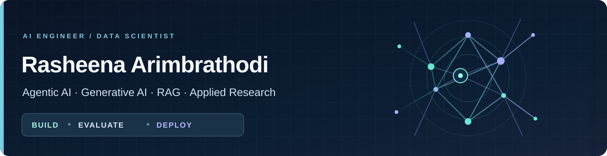

  

  
  
  
  

### Hello, I'm Rasheena.

I'm an **AI Engineer and Data Scientist** who enjoys taking AI from **research and experimentation to reliable, real-world systems**. My work spans **agentic AI, generative AI, hybrid RAG, LLM evaluation, multilingual NLP, and data science**.

At **Accenture**, I develop enterprise AI applications and the engineering around them: retrieval quality, secure integrations, asynchronous services, observability, and deployment. Previously, I worked with **AI4Bharat** on multilingual OCR, model evaluation, and open-source LLM inference for Indian languages.

I believe the interesting part of AI begins *after* the first successful demo: when you have to make it **accurate, measurable, secure, scalable, and useful**.

---

### What I work on

| Focus | What it means in practice |
| :--- | :--- |
| **Agentic AI & orchestration** | Tool calling and routing, agent workflows, structured outputs, context management, and service integration. |
| **RAG & knowledge systems** | Hybrid retrieval, embeddings, BM25, semantic search, cross-encoder re-ranking, and grounded generation. |
| **Production AI engineering** | Python/FastAPI, async APIs, SSE, Docker, cloud deployment, retry/fallback strategies, and operational reliability. |
| **AI quality, safety & evaluation** | Retrieval evaluation, hallucination mitigation, PII protection, model benchmarking, and performance analysis. |
| **Data science & applied research** | Predictive ML, NLP, multilingual OCR and translation, feature engineering, SQL, and experimental evaluation. |

### Selected work & research

> **A note on code:** Enterprise engagements below describe professional experience, not publicly released client repositories. Any public demos I publish will use original code and non-confidential data.

**01 / Enterprise knowledge retrieval & hybrid RAG** · *Professional work*

Built and deployed an enterprise **FastAPI-based knowledge retrieval service** with **Azure OpenAI, Azure AI Search, and LlamaIndex**. Designed hybrid retrieval with vector search, BM25, semantic ranking, and re-ranking; integrated it with agentic workflows through SSE. Focused on evaluation, PII protection, managed identity, and resilient API behavior.

**02 / Agentic applications & decision workflows** · *Professional work*

Developed agent workflows for **audience segmentation, business analysis, and reporting**, bringing together tool calling, prompt design, structured outputs, and asynchronous service integrations. Worked on improving execution reliability, memory usage, and AI-generated output consistency.

**03 / Multilingual OCR & efficient LLM inference** · *AI4Bharat research*

Evaluated OCR systems across **22 Indian languages**, explored Transformer-based post-OCR correction, and benchmarked open-source LLM inference. Worked with **PyTorch, Ollama, NVIDIA NIM, and INT8/FP16 quantization** in a multi-GPU research environment.

**04 / LLM translation evaluation** · *Master's thesis*

Benchmarked **Llama 3.1 (8B, 70B, and 405B)** for translation across Indian languages, using **BLEU, chrF++, IN22-Conv, and FLORES-200** to study performance differences across language families and resource levels.

**05 / Document intelligence & predictive ML** · *Independent and earlier work*

Built invoice-extraction pipelines combining **PDF parsing, OCR, and LLM-based extraction** with field-level validation. Earlier ML projects included **XGBoost-based regression**, question classification, and structured-data analysis.

### Engineering toolkit

**LLMs & agents:** Python · Azure OpenAI · LlamaIndex · LangChain · Google ADK · Hugging Face · Ollama · Prompt Engineering

**Retrieval & evaluation:** Azure AI Search · RAG · Embeddings · BM25 · Hybrid Search · Re-ranking · RAG Evaluation

**Backend & cloud:** FastAPI · REST APIs · Async Python · SSE · Docker · Azure · Google Cloud · AWS · CI/CD

**Data & ML:** SQL · Pandas · NumPy · Scikit-learn · XGBoost · PyTorch · TensorFlow · NLP · OCR

### My journey

- **Now:** AI Decision Science Analyst at **Accenture**, building and supporting enterprise AI solutions.
- **2025:** AI Research Intern at **AI4Bharat**, exploring multilingual OCR and efficient open-source LLM inference.
- **2023–2025:** **MSc in Data Science & Artificial Intelligence**, IIT Madras and the University of Birmingham, UK (**9.25/10** at IIT Madras; **First Class with Honours** at Birmingham).
- **Earlier:** Data science and machine-learning projects across prediction, classification, and business analytics.

### What I'm excited to explore

I'm especially interested in **evaluation-driven agent development**, **trustworthy knowledge systems**, **efficient open-source LLMs**, and **AI that works across languages and communities**.

<strong>Build thoughtfully. Evaluate rigorously. Ship responsibly.</strong>

  <a href="https://github.com/Rasheena-Arimbrathodi?tab=repositories">Explore my repositories</a> ·
  <a href="https://www.linkedin.com/in/rasheena-arimbrathodi-30275b3a/">Connect on LinkedIn</a> ·
  <a href="mailto:rasheena.arimbrathodi@gmail.com">Get in touch</a>

